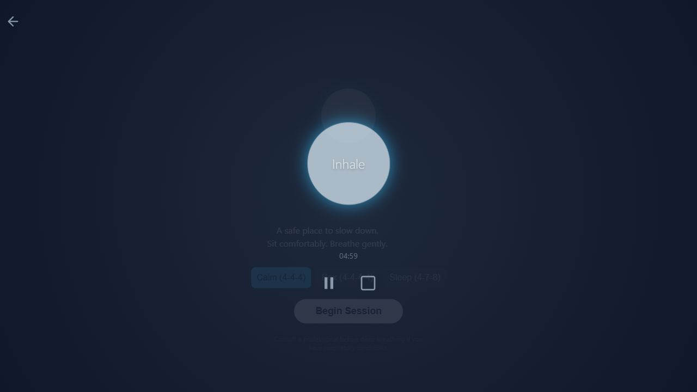

# CalmSpace Focus Studio

A collection of small browser tools for breathing exercises, focus sessions, ambient sound, drawing and playful breaks. Built with HTML, CSS, JavaScript and Canvas.

[Open the browser demo](https://lakshaywalia.com/demos/calmspace-focus-studio/) · [Portfolio](https://lakshaywalia.com/projects.html)

## Run locally

```bash
python -m http.server 8000
```

Open <http://127.0.0.1:8000>. A static web server is enough; there is no backend or database.

```bash
docker build -t calmspace .
docker run --rm -p 127.0.0.1:8080:80 calmspace
```

## Scope

The repository contains the original browser tools. Audio playback starts through user interaction, and browser support varies for audio and animation features. There are no accounts or server-side user records.

Kubernetes manifests are example deployment files. Their presence does not establish that a public cluster is running.

## Contents

- `index.html`: tool launcher
- `tools/`: focus, breathing, sound, drawing and other interactive pages
- `Dockerfile`: nginx static hosting
- `k8s/`: example Kubernetes deployment

## Verified local demonstration

A fresh Docker build served the tool launcher, and beginning a breathing session started the phase indicator and countdown.


