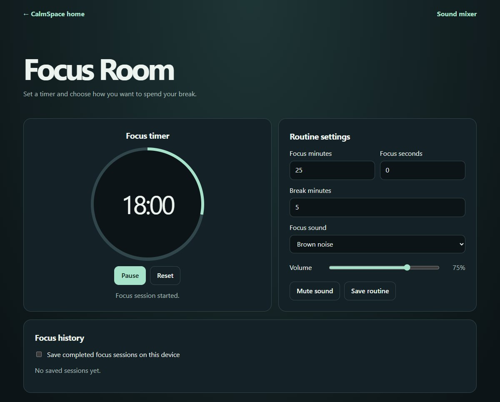

# CalmSpace Focus Studio

A collection of 11 browser tools for focus sessions, guided breathing, ambient sound, drawing, and playful breaks. Built with HTML, CSS, JavaScript, Canvas, and Web Audio.



[Original portfolio demo](https://lakshaywalia.com/demos/calmspace-focus-studio/)

## Features

- **Focus Room** has a 25-minute default timer, custom durations, pause and resume, and timed or guided breathing breaks. Save your routine to start it from the home page.
- **Sound Mixer** combines white, pink, and brown noise with generated rain and fan sounds. Adjust each layer, save named mixes, and use them in the Focus Room.
- **Focus history** is optional and stays in your browser. It shows daily focus totals and includes a clear-history control.
- **Write and Forget** discards new text. If an older version saved entries in this browser, the tool offers to delete them.
- **Tool shortcuts** include favorites and recently opened tools. The site can be installed in supported browsers and all 11 tools work offline after the initial cache is ready.

## Run locally

```bash
python -m http.server 8000
```

Open <http://127.0.0.1:8000>. A static web server is enough to run the app. The offline cache requires HTTPS or localhost. Audio starts from a user interaction. After launching a saved routine from the home page, select **Enable sound** if your routine includes a mix.

```bash
docker build -t calmspace .
docker run --rm -p 127.0.0.1:8080:80 calmspace
```

## Browser smoke tests

```bash
npm install --no-save --no-package-lock playwright@1.62.1
npx playwright install chromium
node --test tests/smoke.cjs
```

GitHub Actions runs the smoke tests and builds the Docker image. For releases that change cached files, update the version and file list in `sw.js` so existing installations receive the new assets. The `k8s/` manifests are examples for container hosting.
